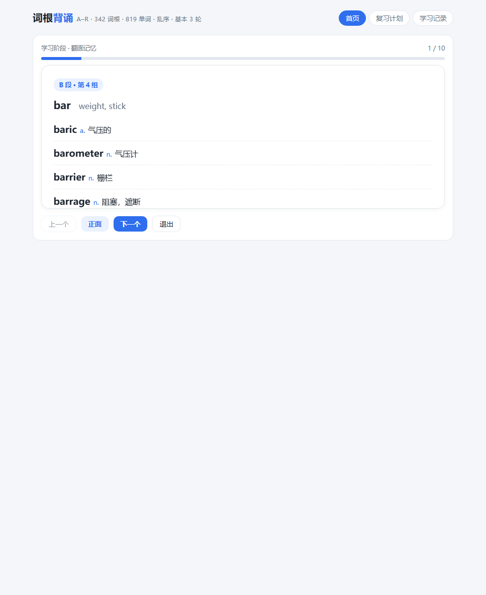
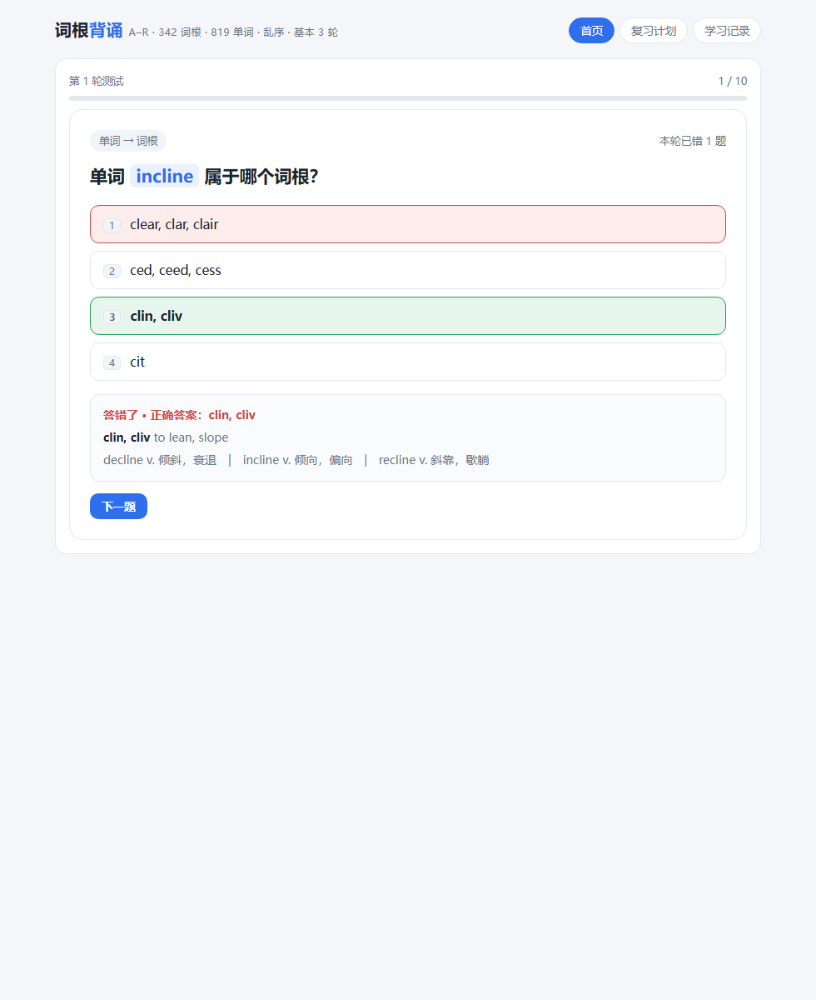
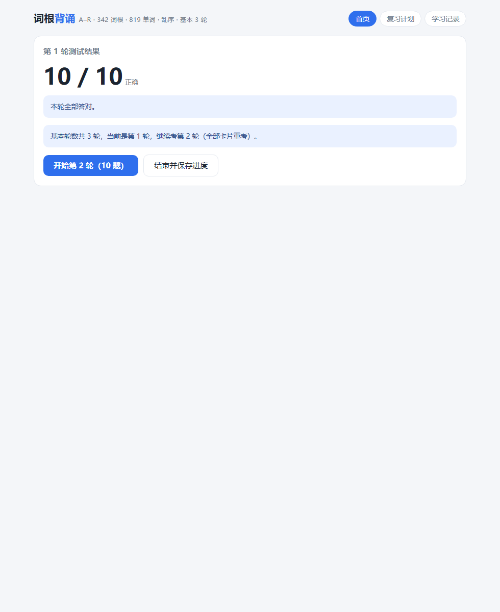
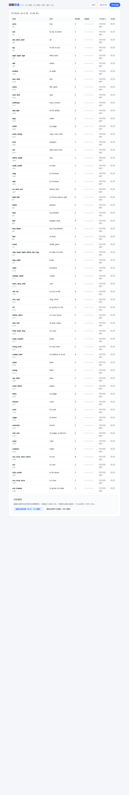

# RootLearner · 词根背诵 — 提交主文档

| | |
|---|---|
| 姓名 | 甘允迪 |
| 院系 | 北京大学数学科学学院 |
| 课程 | 计算概论（B）· 2026 秋 |
| 项目名称 | RootLearner（词根背诵） |
| GitHub 仓库 | https://github.com/gyd-07/RootLearner |
| 提交版本 | 标签 `v1.0` |

> 本文档为 Canvas 提交 PDF 的源稿；与仓库 `README.md` 内容一致（此处为摘编），截图位于仓库 `docs/` 目录。

## 一、项目背景与目标

- **为谁解决什么问题**：为本人及有同类需求的学习者背诵英语词根与派生词。原有方式（纸质词根表、自制旧 Qt 程序）不能乱序背诵、多轮自测、间隔复习，且无法在手机上使用。
- **已完成功能**：字母范围与每日数量选择、范围内乱序背诵、翻面卡片学习、6 种题型四选一测试、基本 3 轮＋错题补考（上限 8 轮）、艾宾浩斯间隔复习（1/2/4/7/15/30 天）、复习计划看板、学习记录、按范围/全部两级进度重置。
- **怎样判断功能完成**：`tests/test.mjs` 73 项无头断言全绿；headless Chrome 渲染成品截图人工核对。
- **适用范围**：词库覆盖 A–R 共 342 词根组 / 819 单词（无 K、无 S–Z、无前缀后缀，为数据来源边界）。

## 二、课程知识与核心设计

- **哈希表思想**：学习记录 `DB.rec` 以词根 id 为键（普通对象），查改 O(1)；对比数组存记录的 O(N) 扫描。
- **乱序池**：`DB.orderPool` 数组存选定范围的一个完整随机排列（O(N) 空间），持久化保证跨会话稳定；Set 做 O(N) 完整性校验。
- **Fisher-Yates 洗牌**（O(n)）：乱序池、每轮题序、选项顺序三处复用。
- **间隔复习调度**：等级 level∈[0,6] 映射间隔表 [1,2,4,7,15,30]；会话结束统一结算（全对 level+1 排新间隔，答错归零明天重来）；复习队列为 O(N) 过滤，计划按 7 天分桶。
- **状态机**：页面 view × 会话 phase 双层状态机；轮次推进条件集中于 `mustContinue()/canContinue()` 两函数，杜绝条件散写（历史上散写曾导致"全对时第 1 轮就结束"的真 bug）。
- **安全**：全部词库文本经 `esc()` HTML 转义后入 DOM，防注入。
- **取舍分析**：`byId()` 为 O(N) 线性查找，可建 Map 改 O(1)，但 N=342 且调用频次低，保留数组以简化数据结构；单文件零依赖是产品约束（双击即用），逻辑/界面分离以文件内三层（纯逻辑层、渲染层、事件委托层）实现，无头测试可脱离浏览器驱动逻辑层即为证明。

## 三、安装与运行

- **使用**：双击仓库根 `root-learner.html`，任意现代浏览器打开即用；无服务器、无网络、零依赖。
- **构建/测试**（开发者可选）：Node.js ≥ 16，零第三方依赖；`npm run build` 构建（含构建期语法自检），`npm test` 跑 73 项断言。
- **注意**：进度存 localStorage，按文件完整路径隔离。

## 四、功能展示（核心截图）

首页（范围/每日数量/乱序说明/重置入口/统计）：


学习阶段翻面卡片：



测试答题反馈与讲解：



轮次小结与补考推进：



学习记录与两级进度重置：



## 五、测试与结果

- `node tests/test.mjs` → **73 passed, 0 failed**（Node v24 实测）。
- 原理：从构建产物抽真实 `<script>`，`node:vm` + 假 DOM/假 localStorage 无头执行，点击真实渲染按钮驱动全流程。
- 覆盖：范围乱序持久化与重排；轮数边界（全对考满 3 轮、补考只考错题、全错上限 8 轮）；进度重置（范围内/全部、范围外记录保留）；6 题型选项正确性与去重；键盘流；**边界与异常**（localStorage 损坏回退、被禁用降级内存、范围倒置纠正、每日数量越界钳制）。
- 界面验证：headless Chrome 截图人工核对；目录重组后构建产物 sha256 与重组前逐字节一致。

## 六、局限与改进

- 词库仅 A–R 词根部分；词根无中文释义。
- 进度仅本浏览器 localStorage，无同步/导出导入。
- 中途退出会话不保存测试结果；"今日新学完成前不学新词"为软引导。
- 后续：进度导出/导入、错题本、补全词库。

## 七、数据来源

- `src/vocab.json` 由自备 `data.txt`（826 行 7 字段，来自本人旧 Qt 背诵程序）解析清洗；另有一份《Roots, Prefixes and Suffixes (2026)》PDF 素材，其提取结果含 OCR 噪声未采用。
- 仓库不含密钥、密码或凭据。

## 八、来源与 AI 使用声明

```text
使用工具：DeepSeek Agent（v1/v2 功能实现与交接文档）、Qoder（提交合规化：目录重组、Git 仓库、README、边界测试）
参与环节：需求梳理、代码生成、测试编写、文档整理
本人完成的设计、修改与判断：功能取舍与歧义澄清（乱序＝选定范围内生成一组排列而非每题独立随机、基本 3 轮＋补考上限 8 轮、两级重置粒度）；词库数据的提供与清洗验收；headless 截图人工核对；对 AI 方案的采纳与否决
验证方法及结果：73 项无头断言全绿（node tests/test.mjs）；headless Chrome 截图核对；目录重组后构建产物 sha256 与重组前一致
代表性协作案例或记录位置：docs/任务交接总览.md §5.3——两个真 bug（乱序顺序未持久化、全对时第 1 轮就结束）均由测试断言发现而非肉眼审查
引用与复用的外部资源：课程《计算概论（B）》作业说明与讲义（github.com/GMyhf/2026fall-cs101）；艾宾浩斯间隔序列为通用学习科学常识；未复用任何第三方代码或库（项目零依赖）
```
